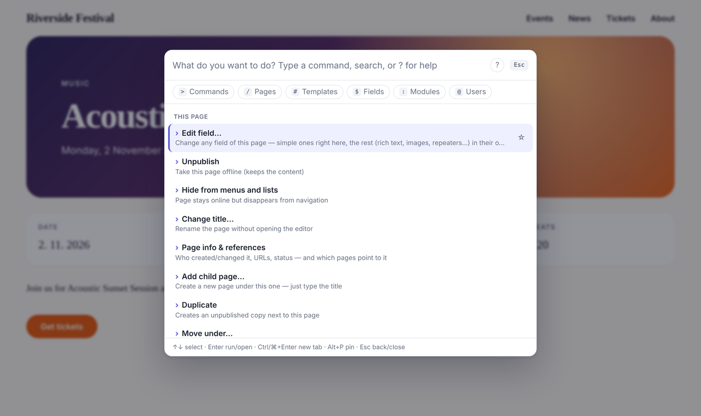
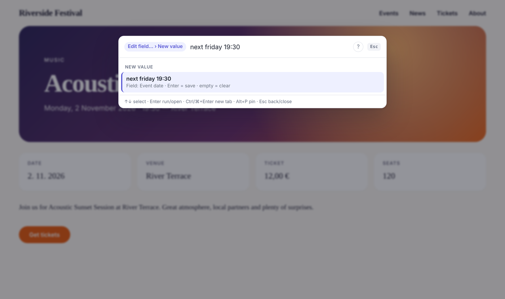
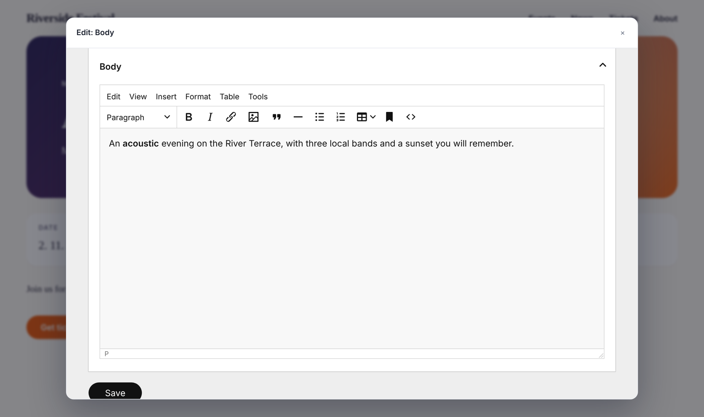
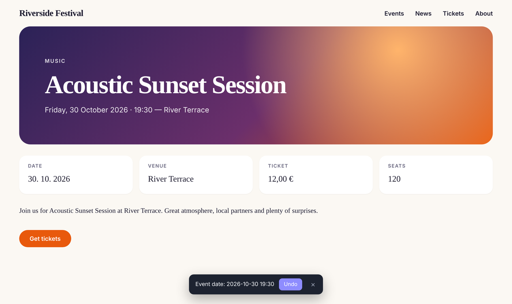
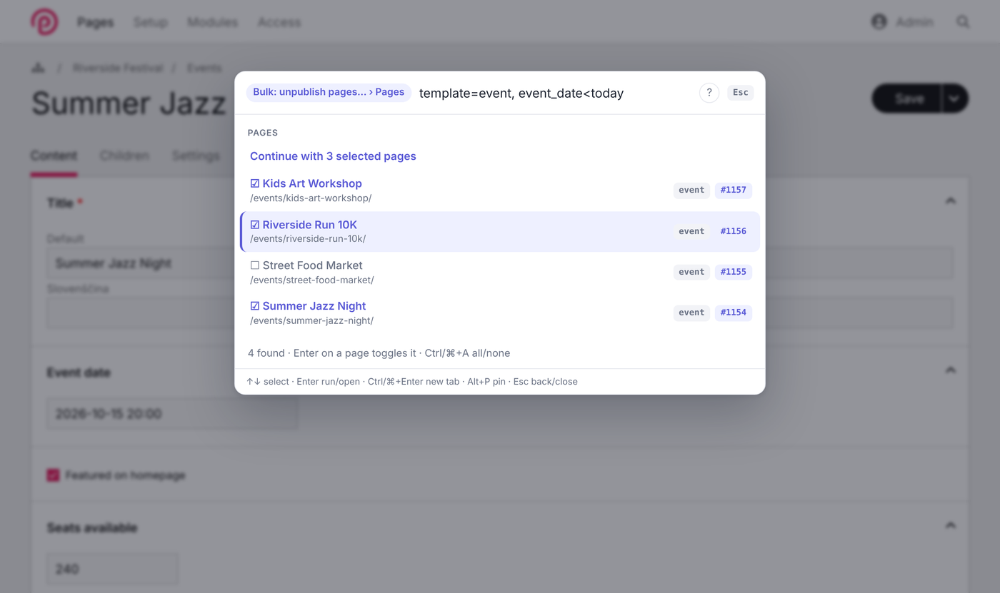
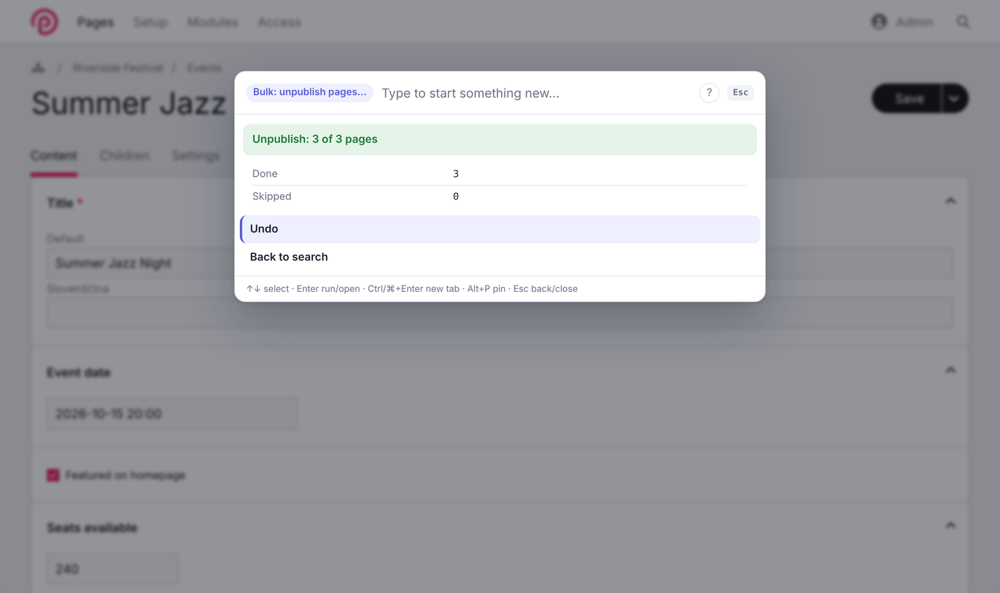
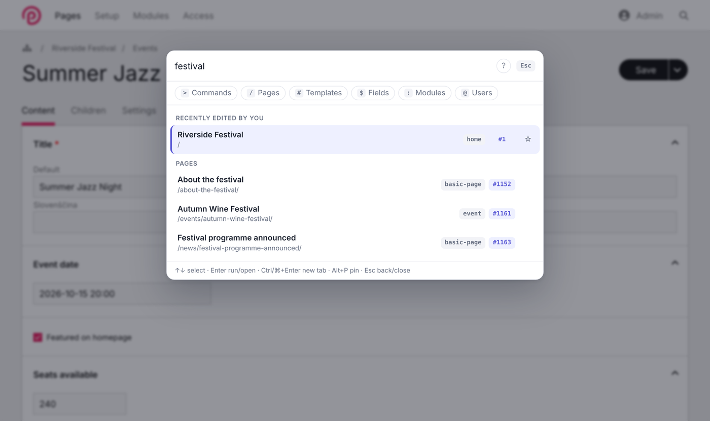
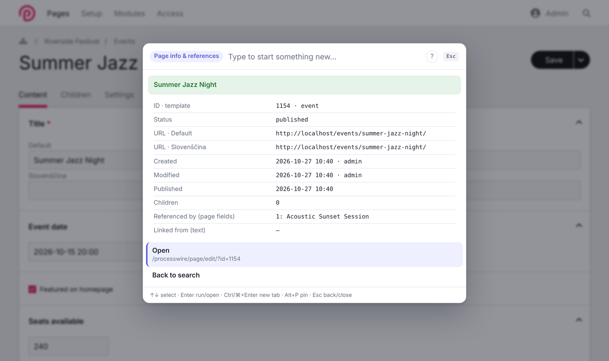
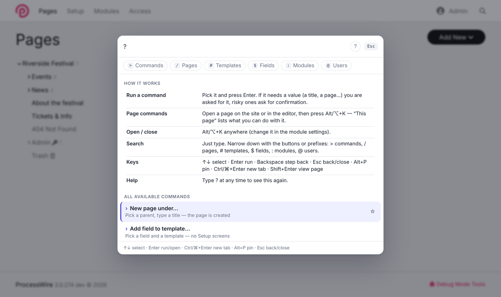
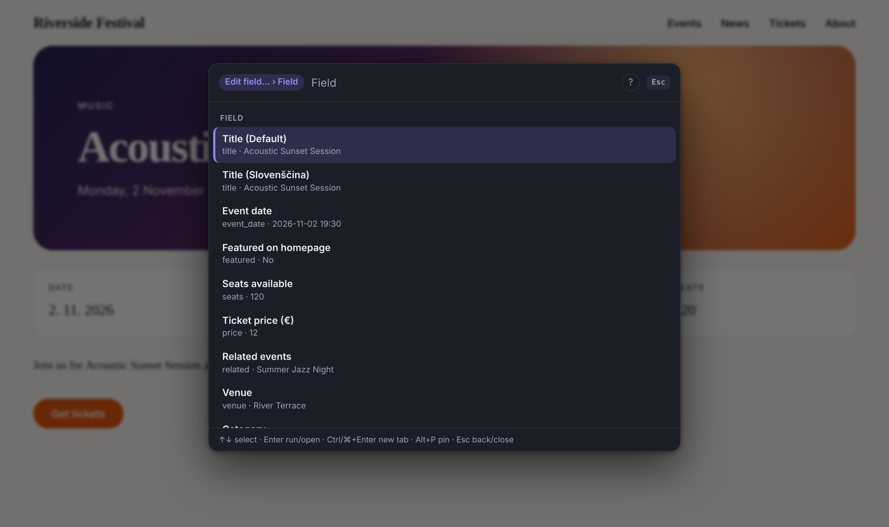

# Native Command

**A keyboard command palette for ProcessWire — in the admin *and* on the front-end.**

Press **Alt+K** (Option+K on Mac — or any shortcut you like) on any page of your site and act on it right there: edit any field, publish, rename, duplicate, move or trash it — and undo any of it. Bulk-edit hundreds of pages with a selector, see who points to a page before you delete it, and jump to any page, template, field, module or user in two keystrokes.

Think **Spotlight / Raycast** or the **VS Code command palette** — for your ProcessWire site. Works with any site profile, any templates and any fields. No dependencies.



---

## Why you'd want it

| You want to… | Usually | With Native Command |
|---|---|---|
| Fix a typo you just spotted on the live site | admin → find the page → edit → save → back | `Alt+K` · `title` · type · Enter |
| Move an event to next Friday | admin → page → date field → datepicker → save | `Alt+K` · `edit` · `date` · `next friday 19:30` |
| Unpublish all events that already happened | open each one, uncheck, save — ×20 | `bulk unpublish` · `template=event, date<today` · Enter |
| Know whether a page is used before deleting it | — | `Alt+K` · `info` |
| Undo a mistake | — | click **Undo** |
| Get to a page / template / field / module / user | menus, search screen | `Alt+K` · type · Enter |

It doesn't replace the page editor — it's for the hundreds of small things that don't deserve five screens.

## Features

### Act on the page you're looking at
On the front-end (for logged-in editors) or on the page open in the admin editor:

- **Edit field…** — *any* field.
  - Simple fields are edited right in the palette: text, number, price (`12,50` works), date (`5.11.2026 18:00`, `next friday 19:30`), checkbox, toggle, Options and Page reference (every setup: parent, template, selector incl. `page.` context, custom code or “any page”). The current value is pre-filled, only valid choices are offered, multi-language fields can be set per language.
  - Everything else — rich text, images, files, repeaters, Repeater Matrix, Combo, Table, map, third-party fields, and multi-line text — opens **ProcessWire's own editor** in a modal, showing just that field. Full toolbar, uploads and validation; the page refreshes after saving.
- **Publish / Unpublish** (publishing is refused while required fields are empty, like in the page editor), **Hide / Show in menus**
- **Change title…**, **Add child page…**, **Duplicate**, **Move under…**, **Move to trash**
- **Page info & references** — ID, template, status, URLs in every language, created/modified by whom, and *which pages reference or link to it*. Move and Trash warn you about it.

| | |
|---|---|
|  |  |

### Undo — everything
Every change made through the palette (fields, title, status, move, trash, duplicate, new page, whole bulk batches) can be undone: from the toast after the page reloads, from the result screen, or with the *Undo* command. The last 10 changes are kept per user session; permissions are checked again when undoing.



### Bulk actions with selectors
**Bulk: publish / unpublish / hide / show / move / trash / set field** on any set of pages. Pick them with words (`news`) or a real selector (`template=event, date<today`). All pages you may edit are pre-selected (up to 500); untick the ones to keep, Ctrl/⌘+A for all/none. Every page is checked individually, you get a *done / skipped (and why)* summary, and **one Undo reverses the whole batch**.

| | |
|---|---|
|  |  |

### Search & jump
Pages (title, name, ID, template or a selector), every admin screen including module sub-screens, templates, fields, modules and users. Every page shows its **template and ID** — click the `#ID` to copy it. Narrow down with the buttons or prefixes: `>` commands · `/` pages · `#` templates · `$` fields · `:` modules · `@` users.

| | |
|---|---|
|  |  |

### And more
- **Instant answers:** *System info*, *Latest errors* and *Page info* answer inside the palette.
- **Global commands:** New page under…, Add field to template…, Clear caches (WireCache + ProCache), Refresh modules.
- **Shortcuts without code** — your own commands in the settings, optionally per role.
- Pins (Alt+P or ☆), recently used items, `?` for built-in help, keyboard-only, light & dark mode, Konkat / UIkit friendly.

| | |
|---|---|
|  |  |

## Install

1. Download the ZIP (or install from the modules directory with the class name `NativeCommand`).
2. Put the `NativeCommand` folder into `/site/modules/`, then *Modules → Refresh* and install **Native Command**.
3. Press **Alt+K** (Option+K on Mac) anywhere. Type `?` to see what you can do.

**Requirements:** ProcessWire 3.0.200+ · PHP 7.4+

Tested with ProcessWire 3.0.200 (MySQL/MariaDB) and 3.0.274 (SQLite), PHP 8.3, classic UIkit and Konkat admin themes, CKEditor and TinyMCE.

**Uninstall:** nothing is added to your database, templates or fields — uninstalling removes the module and its settings. The optional `native-command` log file stays in *Setup → Logs* until you delete it.

## Using it

- **Alt+K** (default) opens and closes the palette, **/** opens it when no input is focused.
- **↑ ↓** select · **Enter** run or open · **Ctrl/⌘+Enter** open in a new tab · **Shift+Enter** open the page on the front-end.
- Commands that need a value ask for it; **Backspace** on an empty value steps back, **Esc** returns to search, **Esc** again closes.
- **Alt+P** pins the selected item to the top.

### Choosing the shortcut
In the module settings pick a modifier (Alt/Option, Ctrl/Cmd, Ctrl/Cmd+Shift or Ctrl/Cmd+Alt) plus any letter or digit — e.g. Ctrl/Cmd+K or Cmd+P. The key is matched physically, so it works on every keyboard layout, and the palette takes the shortcut so nothing else opens with it. The default is Alt+K because the Konkat admin theme uses Ctrl/Cmd+K for its own search.

## Settings

- **Basics:** shortcut (modifier + key) · open with `/` · enable on the front-end · Shortcuts
- **Advanced:** sources (commands, admin screens, pages, templates, fields, modules, users) · results per group · log data-changing commands · list of all registered commands

### Shortcuts
One per line — `Label | target | roles (optional, comma separated)`:

```
New event | new /events/ event | editor
News post | new /news/
Ticket report | https://tickets.example.com/report
Orders | /processwire/shop/orders/
```

`new /parent/path/ template` asks for a title and creates the page there (unpublished, opens in the editor). Without a template it is chosen like *Add child page* does. A URL target is a link.

## Security

- Available to superusers and users with `page-edit`. Every command, page and field is checked against the user's permissions **on the server, again when it runs** (`editable()`, `publishable()`, `moveable()`, `trashable()`, field-level access…).
- Commands run only via POST with ProcessWire's CSRF token; arguments are sanitized by type.
- Selectors typed by users can't widen access: `include`, `check_access`, `limit`, `status` and `has_parent` are removed, and non-superusers can't search by fields they're not allowed to view.
- Risky commands ask for confirmation; in the editor you're warned about unsaved changes.
- Multi-line, rich-text, hidden and locked fields are never edited in the single-line input.
- Data-changing commands are written to the `native-command` log (optional).
- The front-end needs no inline script, so it also works with a strict Content-Security-Policy.

## For developers

Add your own commands from any module or `/site/ready.php`:

```php
$wire->addHookAfter('NativeCommand::registerCommands', function(HookEvent $e) {
	/** @var NativeCommand $nc */
	$nc = $e->object;

	// read-only answer shown inside the palette
	$nc->addCommand('orders.open', [
		'title' => 'Open orders',
		'permission' => 'order-view',
		'mutates' => false,
		'handler' => function(array $args, ?Page $page, NativeCommand $nc) {
			$rows = [];
			foreach($nc->wire()->pages->find('template=order, paid=0, limit=8') as $o) {
				$rows[] = [$o->title, $o->total . ' €'];
			}
			return ['message' => count($rows) . ' open orders', 'rows' => $rows, 'open' => '/processwire/orders/'];
		},
	]);

	// command with arguments
	$nc->addCommand('orders.new', [
		'title' => 'New order for…',
		'keywords' => 'order create',
		'permission' => 'order-edit',
		'args' => [
			['name' => 'customer', 'type' => 'page', 'label' => 'Customer'],
			['name' => 'amount', 'type' => 'int', 'label' => 'Amount (€)', 'required' => false],
		],
		'handler' => function(array $args, ?Page $page, NativeCommand $nc) {
			$order = $nc->wire()->pages->new(['template' => 'order', 'parent' => '/orders/', 'title' => 'Order for ' . $args['customer']->title]);
			return ['message' => 'Order created', 'redirect' => $order->editUrl()];
		},
	]);

	// command for the page being viewed/edited, with undo
	$nc->addCommand('event.soldout', [
		'title' => 'Mark as sold out',
		'context' => 'page',
		'available' => function(?Page $page) { return $page && $page->template == 'event' && $page->editable('seats'); },
		'handler' => function(array $args, ?Page $page, NativeCommand $nc) {
			$field = $nc->wire()->fields->get('seats');
			$nc->pushUndo('fields', $page, 'Sold out', ['fields' => ['seats' => $field->type->sleepValue($page, $field, $page->getUnformatted('seats'))]]);
			$page->setAndSave('seats', 0);
			return ['message' => 'Sold out', 'reload' => true];
		},
	]);
});
```

### Command definition

| Key | Type | Default | |
|---|---|---|---|
| `title` | string | id | Shown in the palette (end it with “…” when it asks for values) |
| `summary` | string\|callable(?Page) | `''` | Subtitle |
| `keywords` | string | `''` | Extra search words |
| `context` | `global`\|`page` | `global` | `page` = needs the current page |
| `permission` | string | `''` | Permission name, or `superuser` |
| `available` | callable(?Page, NativeCommand): bool | — | Fine-grained visibility, re-checked at run time |
| `args` | array | `[]` | Each: `name`, `type`, `label`, `required` (true), `default` |
| `confirm` | string\|callable(?Page) | `''` | Adds a confirmation step |
| `mutates` | bool | `true` | Changes data → logged + unsaved-changes guard |
| `group` | string | auto | Palette group |
| `handler` | callable(array $args, ?Page $page, NativeCommand $nc) | required | Returns a string or a result array |

**Argument types:** `text`, `int`, `page` (→ `Page`), `template` (→ `Template`), `field` (→ `Field`), `pages` (multi-page picker → `PageArray` of editable pages), `choice` (`options` = callable(?Page, array $previousArgs, string $query, NativeCommand) returning `[['value', 'label', 'summary', 'selected'], …]`, or `null` for free text with `default` = callable(?Page, array $previousArgs)). Objects are validated against the user's access before your handler runs. Throw a `WireException` to show its message as an error.

**Result array:** `message` · `rows` (`[[label, value], …]`) · `open` (URL offered as next step) · `redirect` · `reload` · `type` (`success`|`error`).

**Helpers:** `bulkRun(PageArray $pages, $title, callable $check, callable $apply)` (per-page skip reasons, summary and one combined undo) · `pushUndo($type, $page, $label, $data)` (types `fields`, `status`, `parent`, `trash`, `created`) · `movePage($page, $parent)` · `createChild($parent, $title, ?Template $template)` · `missingRequired($page)` · `removeCommand($id)` to disable a built-in.

**Plain links:** hook `NativeCommand::getCustomLinks($q, $scope)` and return `[['t' => 'Title', 's' => 'Subtitle', 'u' => '/url/'], …]`.

**JavaScript:** `NativeCommand.open()`, `NativeCommand.close()`, `NativeCommand.run('cache.clear')`.

## Translations

All texts are translatable: *Setup → Languages → (language) → Translate files → NativeCommand.module.php*.

## Support

Questions, ideas and bug reports: the ProcessWire forum support thread or [GitHub issues](https://github.com/Roychgod/NativeCommand/issues). Please include your ProcessWire and PHP version.

## License

[MIT](LICENSE) © Gregor Rojko, [Pyxios](https://pyxios.com)
